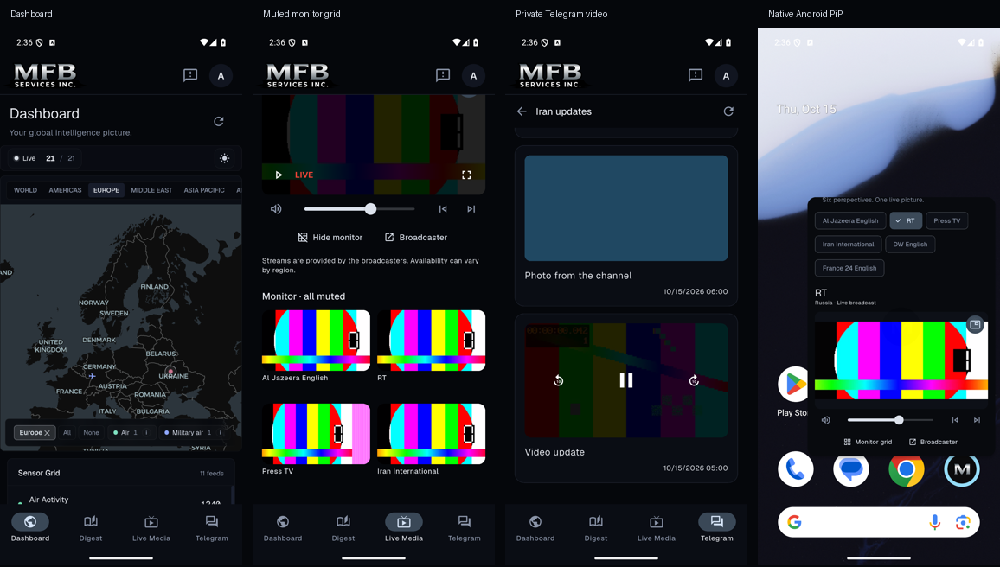

# Four-surface validation

The design and acceptance matrix are in [MOBILE_FEATURE_PARITY_PLAN.md](MOBILE_FEATURE_PARITY_PLAN.md). The baseline is Crucix `17d26fd`; this change does not deploy or modify that server.

## Automated checks

```sh
dart format lib test integration_test
flutter analyze
flutter test --concurrency=1 --dart-define-from-file=config/app_config.json
node --test test/dashboard/embed.test.mjs
```

The new tests cover the browser origin/session boundary, bounded credential refresh, safe route bridging, area-shape API compatibility, Telegram contracts/errors/private images, chat-selection races, media lifecycle/PiP behavior, and retained navigation at phone/tablet widths. Existing Digest, auth, profile, feedback and settings tests remain part of the full run.

## Android integration fixture

This uses the real Crucix React dashboard build with synthetic sweep data, an HttpOnly fixture session, native HLS, and authenticated Telegram attachment endpoints. It does not connect to Firebase or call an AI provider. Only the integration test replaces auth/repository/player factories; normal app startup always uses production dependencies.

Start the Crucix fixture server in its checkout:

```sh
PORT=4173 FIXTURE_UI=react node test/fixtures/server.mjs
```

If its `dashboard/dist` or synthesized fixtures do not exist, run `npm ci`, `npm run build`, and `npm run fixtures:build` in Crucix first. In the mobile worktree:

```sh
mkdir -p build/parity-fixtures
ffmpeg -y -f lavfi -i testsrc2=size=320x180:rate=24 \
  -f lavfi -i sine=frequency=440:sample_rate=44100 -t 6 \
  -c:v libx264 -pix_fmt yuv420p -c:a aac -movflags +faststart \
  build/parity-fixtures/clip.mp4
node scripts/parity-fixture.mjs
```

With an Android emulator running:

```sh
node scripts/parity-android.mjs emulator-5554
```

The Android harness saves Dashboard, monitor grid, Telegram video and native PiP screenshots under `build/`, verifies Android reports a pinned task, and returns the emulator to the app after PiP. It also verifies fullscreen entry/exit, session bootstrap, layer/region restoration and private attachment requests.

The fixture proxy binds loopback, accepts only the literal test token, and exposes request counters at `/__fixture/stats`. It forwards dashboard assets/data to the sibling Crucix fixture server, supplies Telegram snapshots, and serves the existing fixture HLS playlist. Cleartext is enabled only in the Android debug manifest for this loopback test. Release Dashboard origins require HTTPS.

## Platform checks

- Dashboard: native sign-in bootstrap without a second form; source status/theme controls remain visible; duplicate brand/navigation/account controls are hidden; regions/layers/search/selection/briefs/guide remain available; reload and tab restoration; browser streams close on tab leave/background.
- Media: all six channel definitions; switch and previous/next; mute/volume; player loading/error/retry; broadcaster/YouTube alternatives; muted first-four grid; fullscreen and supported-device PiP; no hidden audio/decoders. Broadcaster availability and geographic restrictions remain external conditions.
- Telegram: grouped directory/search/back; connected/disconnected/empty/error; translated-first text/original toggle; link previews and source links; authenticated avatar/photo/full-size photo/video/audio; oversize/unsupported states; refresh and account change.
- iOS physical device: verify WebKit cookie exchange, HLS, fullscreen/PiP, background transitions, large text, safe areas, and four-stream memory pressure. The Linux environment cannot establish an iOS build or device pass.

## Dependency rationale

- `webview_flutter` and its Android/WebKit implementations: system WebView for the full Dashboard and YouTube alternatives; no second map renderer or backend authentication flow.
- `better_player_plus` pinned to `2.0.0`: native Media3/AVPlayer playback, HLS, authenticated headers, fullscreen, and capability-gated PiP. Private media has no disk-cache configuration. iOS minimum remains 15.0, matching the existing app target.
- `integration_test` (Flutter SDK): exercises actual platform plugins on Android. Unit/widget tests replace browser/player/repository seams.

## Evidence

Validated on 2026-10-15 in `feat/mobile-feature-parity`:

- `flutter analyze`: no issues. `dart format --output=none --set-exit-if-changed lib test integration_test`: 202 files checked, no changes.
- Full Flutter regression: 179 tests passed; the profile test process failed to start with the laptop's intermittent `WebSocketException: Invalid WebSocket upgrade request` (also present in the unchanged baseline). Reran the affected profile tests and the current router/shell/Digest/Dashboard tests after the default-route change: all 44 passed. No assertion failures remain in those suites.
- Dashboard JavaScript bridge: all 6 Node tests passed, including URL/Request fetch inputs, shape conversion, route handoff and filter/scroll restoration.
- Android arm64 APK built successfully with the configured HTTPS backend. Installed over the existing app on the user's connected Samsung SM-F976U using the matching local signing certificate; app data preserved. The installed build includes Dashboard as the default and hidden map tools. Signing files and APKs remain ignored.
- Android fixture smoke: authenticated Dashboard, actual map canvas/region/layer interaction and restoration, native HLS/channel/grid, Telegram translation/private images and offscreen SSE cleanup passed. Extended native fullscreen/PiP checks also passed; Android reported `mode=pinned` and the harness returned the emulator to the app.
- Final extended Android harness: passed in 25 seconds after build/install. It tapped the visible PiP control, verified the native pinned task, entered/exited fullscreen, rendered the monitor grid, played the authenticated extensionless Telegram video, restored the Dashboard and confirmed SSE cleanup. Server counters: 8 sessions, 20 private image requests, 1 private video request, 0 open event streams (cumulative fixture run). Screenshots are summarized below.
- Final router/shell/player lifecycle run after the PiP control and deep-link refinements: all 24 tests passed. The native attachment regression fixed a verified player inference failure by explicitly selecting progressive format for extensionless private URLs.


- iOS build/device verification remains unverified on this Linux host. Broadcaster availability and production Telegram account configuration are external conditions.
